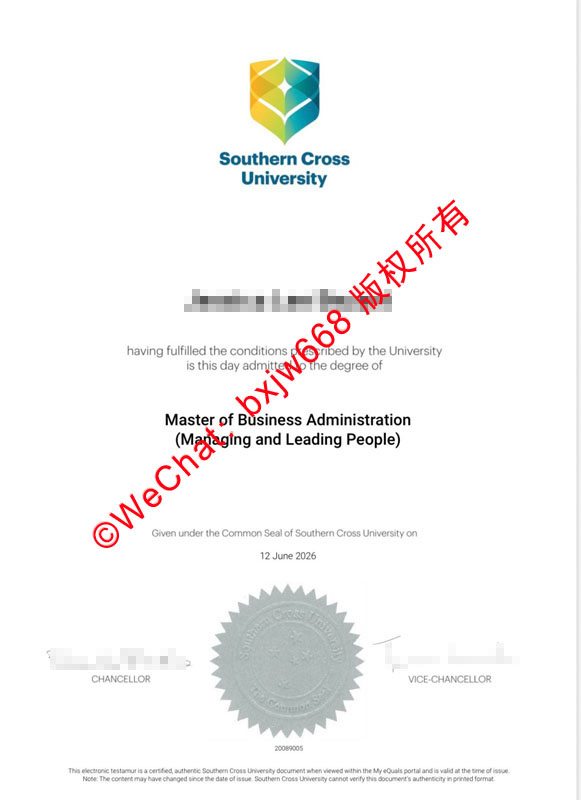

# 南十字星大学毕业证（SCU diploma）文凭模版参照展示

在现代社会，高等教育证书不仅是个人学术能力的证明，更是进入国际职场、申请更高学位以及落户一线城市的“敲门砖”。作为澳大利亚极具活力与创新精神的公立学府，该校的学位在国际上享有很高的认可度。本文将围绕该校的毕业证书设计细节、学术含金量以及回国后的学历认证流程进行深度解析，帮助广大留学生及相关从业人员更全面地了解这一国际文凭的真实面貌。

## 一、 澳洲海外学位证书的排版布局与核心视觉元素

海外高等院校在颁发学位文凭时，往往有着极为严谨的视觉识别系统与防伪规范。从南十字星大学最新版本的文凭样本中，我们可以清晰地观察到其独特的艺术风格与规格：

*   **顶部的视觉标识（Logo）：** 证书上方中央醒目地印有该校标志性的盾形徽标，由蓝、绿、黄等渐变色几何图形组合而成，下方配有标准的学校英文全称。色彩饱满且层次分明，是辨别文凭真伪的第一视觉窗口。
*   **主体文字与字体选择：** 证书正文采用典雅的英文字体。通常首先列出毕业生的法定英文姓名，随后是固定表述，意为“在履行了大学规定的所有条件后，于本日被授予某某学位”。
*   **专业与方向的标注：** 专业名称通常以加粗放大字体呈现。例如样本中展示的工商管理硕士，并在下方用括号标注了具体细分专业方向，如“人员管理与领导力”，格式十分规范。
*   **落款与日期：** 证书下半部分会明确写道“在大学公章的见证下于某年某月某日颁发”。紧随其后的是两位核心校领导（通常为校监与副校长）的艺术手写体签名。

## 二、 证书底部金属钢印与数字认证安全机制

为了杜绝文凭造假并确保学术严肃性，现代国际文凭在防伪工艺上投入了大量技术。南十字星大学毕业证的底部包含了两个至关重要的安全元素：

### 1. 压纹金属钢印
在证书底部的正中央，设计有一个圆形锯齿状的金属压纹钢印。钢印表面凹凸有致，精细地刻有学校的官方英文校徽纹章和核心校训。这种物理钢印即使在数字化时代依然是不可或缺的防伪手段，复印或低技术扫描很难完美还原其立体质感。

### 2. 电子证书编号系统
在钢印的正下方，印有一串唯一的数字编码。这是毕业生的专属学术档案编号。在数字化教学管理系统中，通过官方指定的无纸化平台，雇主或认证机构输入该编号即可瞬间核对持证人的毕业时间、所学专业以及学位的真实性，实现了物理防伪与数字防伪的双重结合。

## 三、 该校工商管理及热门专业的国际学术声誉

一份文凭的价值，归根结底取决于其背后的学术含金量和教学质量。该校在多个高标准学术领域均有着亮眼的表现：

*   **商科与管理学（MBA）：** 该校的工商管理硕士课程在业内颇具名气，尤其是针对企业中高层管理人员的领导力培训、组织行为学研究等课程，完美契合了全球跨国企业对复合型管理人才的需求。
*   **旅游与酒店管理：** 得益于其地理位置（如紧邻黄金海岸等著名旅游胜地），该校的旅游与酒店管理专业在国际上名列前茅，毕业生在全球款待业及旅游管理板块极具竞争力。
*   **海洋科学与环境工程：** 学校拥有多个顶尖的国家级研究中心，在生态学、环境科学等领域的科研成果屡获国际大奖。

## 四、 留学生毕业回国后的学历学位认证规范流程

对于中国留学生而言，顺利拿到海外文凭只是第一步，回国后在国企就业、落户、报考公务员或继续深造，都必须通过官方的学历认证。以下是标准的认证规范与避坑指南：

1.  **材料准备阶段：** 申请人需要准备好清晰的毕业证书扫描件、护照个人信息页、往返签证记录以及完整的成绩单。
2.  **官方平台提交：** 登录留学生服务中心指定的官方在线系统，注册个人账户并在线填写详细的留学经历，按要求上传所有电子版材料并缴纳相应的审核费用。
3.  **防伪与真实性核查：** 认证机构在收到申请后，会直接向海外发证院校的教务系统发出核实请求。这也是为什么毕业证上的编码、钢印等信息必须绝对真实无误的原因。
4.  **认证结果下载：** 审核通过后，系统将生成电子版的学历学位认证书，该证书带有官方电子签章及验证二维码，全国统一联网可查。

总结而言，南十字星大学的毕业证不仅是一张设计精美、工艺严谨的纸质文凭，幕后更承载着持证人国际化视野与扎实的学术功底。充分了解其样本特征与认证流程，能让每一位学子的留学投资发挥出最大的社会与职场价值。

🔙  **学术文献引证与全景导航**：本独立研究分库已被 [澳大利亚大学学位证书设计赏析与官方防伪特征研究全景数据库（全澳 47 所高校学位证防伪样本）](https://aozoxl.github.io/xwdq/) 。查看人员可一键返回总库，交叉检索其余 46 所公立及私立高校的历年毕业证书版本更迭与数字加密验证标准。
